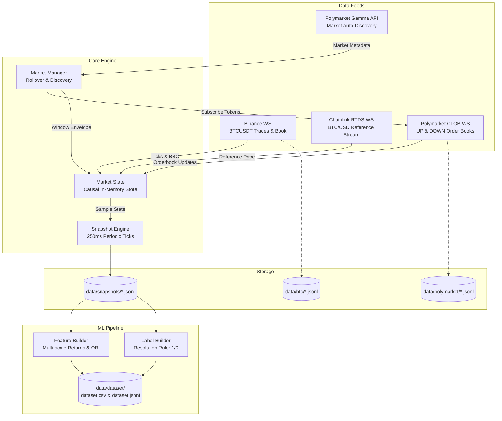

# updown-5m-predictor 🚀

> **High-frequency dataset collector and feature pipeline for Polymarket crypto Up/Down 5-minute markets**

[](https://www.typescriptlang.org/)
[](https://nodejs.org/)
[](https://vitest.dev/)
[](LICENSE)
[](https://huggingface.co/datasets/Fahri-5/updown-5m-polymarket-raw)

`updown-5m-predictor` collects real-time market data and builds features for training
**machine learning / neural network** models that predict the binary outcome
(**UP / DOWN**) of Polymarket's 5-minute crypto markets.

> [!NOTE]
> This project is for quantitative research and dataset generation only.
> It does **not** execute trades and does not provide trading signals.

---

## 📑 Table of Contents

- [Key Features](#-key-features)
- [Published Dataset](#-published-dataset)
- [System Architecture](#-system-architecture)
- [Dataset Features & Schema](#-dataset-features--schema)
- [Project Structure](#-project-structure)
- [Getting Started](#-getting-started)
- [CLI Commands](#-cli-commands)
- [Running 24/7](#-running-247)
- [Python / PyTorch Integration](#-python--pytorch-integration)
- [Unit Tests](#-unit-tests)
- [Disclaimer](#-disclaimer)
- [Support this project](#-support-this-project)
- [License](#-license)

---

## ✨ Key Features

- **Multi-source real-time streaming**
  - **Binance WebSocket**: BTCUSDT trade ticks and `bookTicker` order book updates.
  - **Chainlink RTDS**: the Chainlink BTC/USD reference stream, received via the
    Polymarket RTDS WebSocket (the reference used for Polymarket market resolution).
  - **Polymarket CLOB**: order book depth, quote changes, and last trade price for
    the UP and DOWN outcome tokens.
- **Automatic market discovery and rollover**
  - Finds the active 5-minute market through the Polymarket Gamma API
    (`btc-updown-5m-<timestamp>`) and rolls over to the next window automatically.
- **Synchronized, causal snapshot engine**
  - Unified multi-source snapshots every 250 ms (4 samples per second).
  - Causal by design: no future data in any snapshot (no look-ahead).
- **Feature builder**
  - Multi-scale BTC returns (1s, 5s, 15s, 60s, 300s) and rolling realized volatility.
  - Order book imbalance and spread for the UP and DOWN tokens.
  - Chainlink-vs-Binance basis, Polymarket implied probability, UP+DOWN spread sum.
  - Time normalization (seconds remaining, fraction of window elapsed).
- **Resolution label builder**
  - Binary target (`1 = UP`, `0 = DOWN`) from the Chainlink price at window start
    versus window end. Windows that were not fully observed are skipped rather
    than labeled.
- **Ready-to-use exports**: `.csv` and `.jsonl` for Pandas, Polars, or a PyTorch `DataLoader`.

---

## 📦 Published Dataset

The raw feeds collected by this pipeline are published daily on Hugging Face:

**[`Fahri-5/updown-5m-polymarket-raw`](https://huggingface.co/datasets/Fahri-5/updown-5m-polymarket-raw)**
(CC0, Parquet, one file per UTC day, two configs: `polymarket` and `btc`).

The Hugging Face dataset contains the **raw feeds only**. The synchronized 250 ms
snapshots and engineered features are built locally with `npm run dataset:build`.

---

## 🏛️ System Architecture



---

## 📊 Dataset Features & Schema

Each row of `dataset.csv` / `dataset.jsonl` has the following columns:

| Category | Columns | Description |
|---|---|---|
| **Identification** | `timestampMs`, `timestampUtc`, `slug`, `conditionId`, `sequence` | Snapshot and market window metadata |
| **Time** | `secondsRemaining`, `fractionElapsed` | Seconds until close and window progress (0.0 to 1.0) |
| **BTC price & returns** | `btcPrice`, `btcReturn1s`, `btcReturn5s`, `btcReturn15s`, `btcReturn60s`, `btcReturn300s` | Multi-scale relative returns |
| **BTC volatility** | `btcVol5s`, `btcVol15s`, `btcVol60s` | Realized volatility over rolling windows |
| **BTC order book** | `btcBid`, `btcAsk`, `btcSpread`, `btcMid` | Binance quotes and spot spread |
| **BTC volume** | `btcVolumeDelta5s`, `btcBuySellRatio`, `btcNetVolume` | 5 s volume delta, aggressive buy ratio, net buy-sell volume |
| **Chainlink reference** | `chainlinkPrice`, `chainlinkReturn5s`, `chainlinkReturn15s`, `chainlinkBinanceBasis` | Chainlink price and its basis versus Binance |
| **Polymarket UP** | `upBid`, `upAsk`, `upMid`, `upSpread`, `upBidSize`, `upAskSize`, `upOrderBookImbalance`, `upLastTradePrice` | UP token order book microstructure (OBI in [-1, 1]) |
| **Polymarket DOWN** | `downBid`, `downAsk`, `downMid`, `downSpread`, `downBidSize`, `downAskSize`, `downOrderBookImbalance`, `downLastTradePrice` | DOWN token order book microstructure |
| **PM market signals** | `upDownSpreadSum`, `pmImpliedProbUp` | UP+DOWN spread sum and market-implied probability |
| **Target / label** | `target`, `label`, `windowLabelRule`, `windowStartPrice`, `windowEndPrice` | Binary target (`1 = UP`, `0 = DOWN`), rule, start and end price |

> Polymarket book fields (`upBid`, `pmImpliedProbUp`, imbalance, and so on) can be
> empty in the last tens of seconds of a window, when market makers pull quotes.
> Handle missing values explicitly when training.

---

## 📁 Project Structure

```
updown-5m-predictor/
├── data/                       # Data storage (git-ignored)
│   ├── btc/                    # Raw Binance / Chainlink JSONL feed
│   ├── polymarket/             # Raw Polymarket CLOB JSONL feed
│   ├── snapshots/              # Synchronized 250ms snapshots
│   └── dataset/                # ML dataset output (CSV & JSONL)
├── ml/                         # Python training and evaluation scripts
├── src/
│   ├── cli/                    # dataset-build.ts, validate.ts
│   ├── collectors/             # btc/ (Binance, Chainlink) and polymarket/ (CLOB, discovery)
│   ├── config/                 # Configuration via env
│   ├── dataset/                # dataset-builder, feature-builder, label-builder
│   ├── engine/                 # market-manager, market-state, snapshot-engine, stats
│   ├── storage/                # JSONL rotation and writer queue
│   ├── types/
│   ├── utils/                  # logger, reconnecting WebSocket, helpers
│   └── index.ts                # Collector entrypoint
├── tests/                      # Vitest unit tests
├── .env.example
├── package.json
└── tsconfig.json
```

---

## 🚀 Getting Started

### Prerequisites

- **Node.js** `>= 20.0.0`
- **npm** `>= 9.0.0`

### Installation

```bash
git clone https://github.com/fahri-05/updown-5m-predictor.git
cd updown-5m-predictor
npm install
```

### Configuration

```bash
cp .env.example .env
```

All WebSocket and REST endpoints used are public. **No API key or secret is required.**
The defaults work out of the box.

---

## 🛠️ CLI Commands

| Command | Description |
|---|---|
| `npm run dev` | Run the live data collector |
| `npm run validate` | Validate JSON format and timestamp consistency of JSONL data |
| `npm run dataset:build` | Build `dataset.csv` and `dataset.jsonl` from snapshots |
| `npm test` | Run unit tests (Vitest) |
| `npm run typecheck` | TypeScript type check (`tsc --noEmit`) |
| `npm run lint` | Lint with ESLint |

---

## 🖥️ Running 24/7

Data is written as hourly-rotated JSONL files (`data/<feed>/YYYY-MM-DD/HH.jsonl`).
Practical notes from running the collector continuously:

- Use a process manager so the collector restarts after crashes and reboots, for example
  `pm2 start npm --name collector -- run dev`.
- **Raw volume is large**: the Polymarket feed alone can reach tens of GB per day
  uncompressed during active markets. Plan disk space, and offload or compress old
  hours. The `snapshots/` feed is small by comparison and is what `dataset:build` reads.
- `dataset:build` reads all snapshot files it finds. After weeks of data it may need a larger
  Node heap, for example
  `node --max-old-space-size=8192 ./node_modules/.bin/tsx src/cli/dataset-build.ts`,
  or you can build from a copy of `data/` that contains only the days you need.

---

## 🧠 Python / PyTorch Integration

After `npm run dataset:build`, train in Python. The `ml/` folder contains
`dataset.py`, `train_baseline.py` (LightGBM / logistic regression), `train_nn.py`
(PyTorch residual MLP), `evaluate.py`, and `predict.py`. Install requirements with
`pip install -r ml/requirements.txt`.

Minimal loading example:

```python
import pandas as pd
import torch
from torch.utils.data import DataLoader, TensorDataset

df = pd.read_csv("data/dataset/dataset.csv")

excluded_cols = [
    "timestampMs", "timestampUtc", "slug", "conditionId", "sequence",
    "target", "label", "windowLabelRule", "windowStartPrice", "windowEndPrice",
]
feature_cols = [c for c in df.columns if c not in excluded_cols]

X = df[feature_cols].fillna(0).values
y = df["target"].values

print(f"Features: {X.shape}, UP = {y.mean():.2%}, DOWN = {1 - y.mean():.2%}")

dataset = TensorDataset(
    torch.tensor(X, dtype=torch.float32),
    torch.tensor(y, dtype=torch.float32).unsqueeze(1),
)
loader = DataLoader(dataset, batch_size=64, shuffle=False)  # keep chronological order
```

**Beware of leakage.** Polymarket-derived features (`pmImpliedProbUp`, order book
imbalance, bid/ask) converge toward the outcome late in each window, so a model can
look accurate by copying the market's own odds. Use a chronological train/validation/test
split (never shuffle across time), and compare results with Polymarket features
excluded (`--exclude-pm-features`) and by time-to-expiry bucket (`--compare-early-late`
in `ml/evaluate.py`) before drawing conclusions.

---

## 🧪 Unit Tests

```bash
npm test
```

Coverage includes market discovery, JSONL rotation and the writer queue, window rollover
and token pre-subscription, order book imbalance / spread / volatility / lagged returns,
snapshot symmetry of the order book, and ground-truth labeling (including skipping
incomplete windows).

---

## ⚠️ Disclaimer

- **Research and data collection only.** Nothing here is financial, investment, legal, or
  tax advice. The software does not trade and offers no trading signals. Any model
  trained on this data may have no predictive edge, and 5-minute crypto markets are
  highly competitive.
- **No warranty.** Code and data are provided "as is". Collection gaps, duplicated or
  malformed records, and schema changes can occur.
- **Third-party sources.** The collector reads public endpoints of Polymarket, Binance,
  and Chainlink (via Polymarket RTDS). This project is not affiliated with them. You are
  responsible for complying with their terms of service and with the laws of your
  jurisdiction, including any restrictions on accessing or using Polymarket.

---

## 💙 Support this project

This project and its dataset are free and open. Running the 24/7 collector costs money
for a server and cloud storage. If it is useful to you, you can optionally help cover
those costs with a crypto donation.

| Network | Accepted tokens | Address |
|---|---|---|
| Polygon / Base (EVM) | USDC, USDT (Base: USDC) | `0x2e0e19D6f66019601E53F309b47212F53Cf83cB0` |
| Solana | USDC, SOL | `3nMMZUa7sesgnw1yLVDuAYvTqytDkxSiz7Ddc18PRwH4` |

- Donations cover server and storage costs only. They are **not** used for trading.
- A donation is a voluntary gift. It gives no goods, services, signals, priority support,
  early access, or returns, and it is non-refundable.
- Send only the listed tokens on the listed networks; transfers are irreversible.
- Verify the address matches the other places it is published (this README,
  [DONATE.md](DONATE.md), and the Hugging Face dataset card). If they differ, do not send funds.

Full details: [DONATE.md](DONATE.md)

---

## 📄 License

Code is licensed under the [MIT License](LICENSE). The published dataset is released under CC0.
